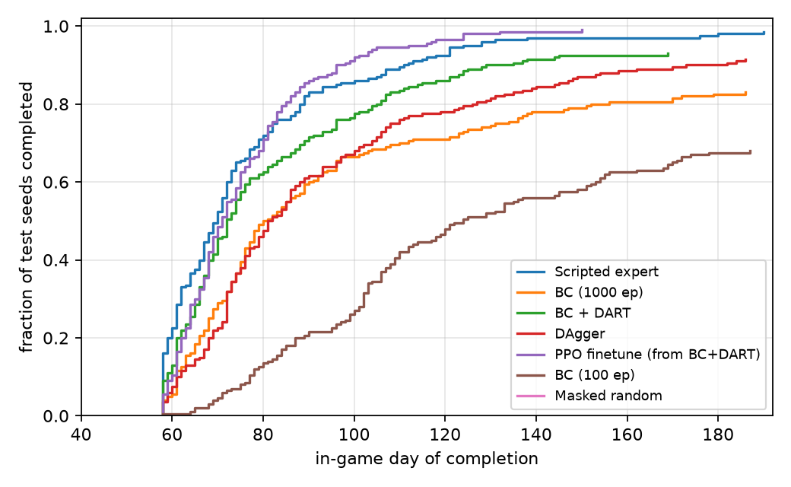
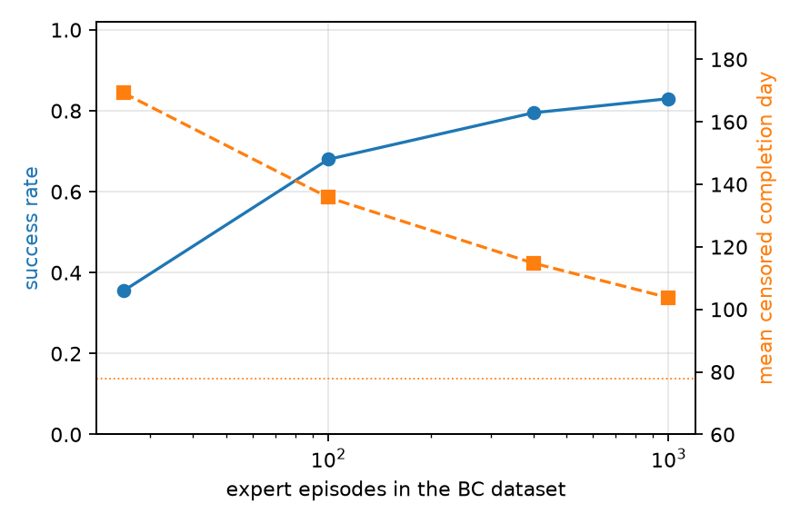
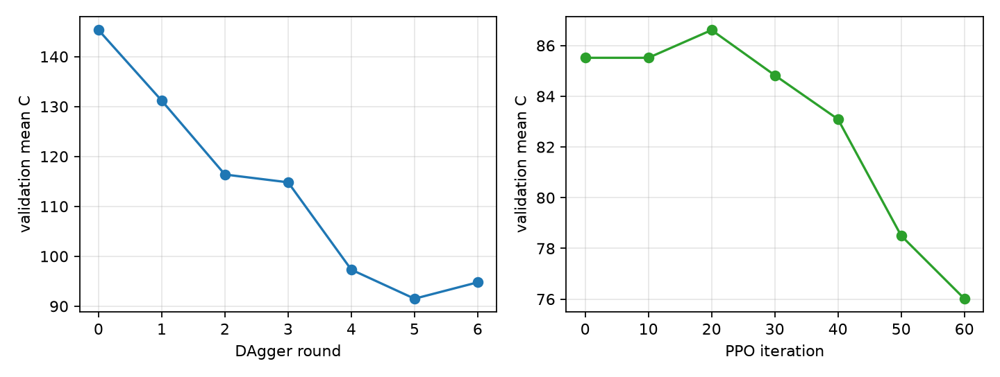

# Results

Generated by `python -m svrl.pipeline --stages report` from `runs/v1/results.json` (git `98c9f3f`, SIM_VERSION 1, content `9280c1da07221cf3`).

Evaluation: 200 held-out **test seeds** (8589934592…8589934791), one episode each, same seeds for every method (paired: identical weather, merchant stock and forage). **C** = in-game day on which all 24 restoration requests are complete, censored at 192 days for failures. Speed score S = (max_days − mean C) / (max_days − mean C_expert); Δ = per-seed C − C_expert. CIs: 95% bootstrap over seeds. Greedy decoding for learned policies.

| Method | Success rate | Mean completion day C (95% CI) | IQM C | Median C | Speed score | Δ vs expert (paired, days) |
|---|---|---|---|---|---|---|
| Masked random | 0.005 | 192.0 [192.0, 192.0] | 192.0 | 192 | 0.00 | 114.1 [110.4, 117.6] |
| Scripted expert | 0.985 | 77.9 [74.4, 81.6] | 69.9 | 70 | 1.00 | 0.0 [0.0, 0.0] |
| BC (25 ep) | 0.355 | 169.2 [163.8, 174.2] | 186.6 | 192 | 0.20 | 91.3 [85.5, 96.5] |
| BC (100 ep) | 0.680 | 135.8 [129.3, 142.2] | 135.6 | 124 | 0.49 | 57.9 [50.3, 65.2] |
| BC (400 ep) | 0.795 | 114.8 [107.9, 121.7] | 102.2 | 96 | 0.68 | 36.9 [30.1, 43.9] |
| BC (1000 ep) | 0.830 | 103.8 [97.3, 110.3] | 86.3 | 80 | 0.77 | 25.9 [19.0, 32.8] |
| BC + DART | 0.930 | 86.9 [82.3, 91.7] | 74.9 | 72 | 0.92 | 9.0 [3.7, 14.5] |
| BC (mixed styles) | 0.950 | 83.4 [79.0, 88.0] | 72.7 | 72 | 0.95 | 5.5 [0.6, 10.5] |
| Filtered BC (fastest 25%) | 0.770 | 109.2 [102.4, 116.2] | 91.2 | 87 | 0.73 | 31.3 [24.3, 38.8] |
| Time-cond. BC (target 55 d) | 0.930 | 85.6 [80.9, 90.6] | 73.0 | 72 | 0.93 | 7.7 [2.3, 13.6] |
| Time-cond. BC (target 65 d) | 0.945 | 85.3 [80.9, 90.4] | 74.2 | 73 | 0.93 | 7.4 [2.6, 12.4] |
| Time-cond. BC (target 75 d) | 0.920 | 87.1 [82.1, 92.7] | 73.7 | 73 | 0.92 | 9.2 [3.9, 14.9] |
| DAgger | 0.915 | 97.8 [92.2, 103.2] | 84.7 | 82 | 0.83 | 19.9 [13.7, 26.1] |
| PPO finetune (from BC+DART) | 0.990 | 76.4 [73.9, 79.2] | 71.9 | 71 | 1.01 | -1.5 [-5.4, 2.2] |

## DAgger

| Round | Samples | Val. success | Val. mean C |
|---|---|---|---|
| 0 | 130,564 | 0.625 | 145.3 |
| 1 | 226,564 | 0.703 | 131.2 |
| 2 | 322,564 | 0.844 | 116.4 |
| 3 | 418,564 | 0.891 | 114.8 |
| 4 | 514,564 | 0.906 | 97.3 |
| 5 | 610,564 | 0.953 | 91.5 |
| 6 | 706,564 | 0.953 | 94.8 |

## PPO finetuning (validation seeds)

| Iter | Val. success | Val. mean C |
|---|---|---|
| 0 | 0.938 | 85.5 |
| 10 | 0.938 | 85.5 |
| 20 | 0.938 | 86.6 |
| 30 | 0.938 | 84.8 |
| 40 | 0.953 | 83.1 |
| 50 | 0.984 | 78.5 |
| 60 | 1.000 | 76.0 |

## Objective tiers (scripted expert vs. masked random)

| Objective | Policy | Success | Mean C | IQM C |
|---|---|---|---|---|
| Fixed | expert | 0.985 | 77.9 | 69.9 |
| Fixed | random | 0.005 | 192.0 | 192.0 |
| Remixed (train pools) | expert | 0.965 | 93.1 | 83.1 |
| Remixed (train pools) | random | 0.000 | 192.0 | 192.0 |
| Remixed (held-out pools) | expert | 0.660 | 114.6 | 105.2 |
| Remixed (held-out pools) | random | 0.005 | 192.0 | 192.0 |

## Simulator throughput (Python → Rust VecEnv, macro actions, this machine)

| Envs | Policy | Macro steps/s |
|---|---|---|
| 16 | random | 28,867 |
| 16 | expert | 36,751 |
| 64 | random | 49,591 |
| 64 | expert | 65,736 |
| 256 | random | 68,691 |
| 256 | expert | 85,864 |

Host: `rig`, Python 3.13.13.
